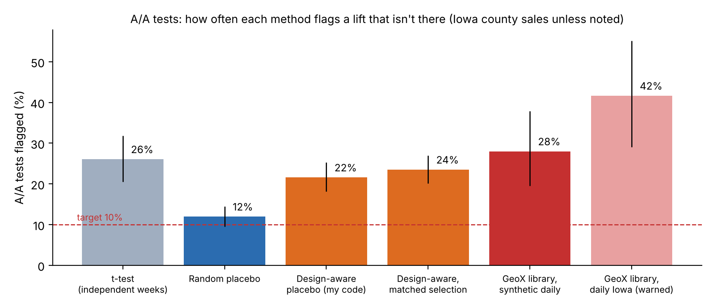

# Google's Meridian GeoX, tested on ten years of real Iowa county sales

An independent rebuild of Ye, Sinn, Li and Jiao (Google, 2026), *Meridian GeoX: An Open-Source Framework for Precision and Efficiency in Geo Experiments* ([paper](https://research.google/pubs/pub1090193/), [code](https://github.com/google/meridian-geox)).

The hypotheses and pass/fail rules were committed before any analysis. See [PREREGISTRATION.md](PREREGISTRATION.md) and the first commit. Steps added after seeing a result are labeled exploratory in the notebook.

Abbreviations: MDE is the minimum detectable effect, TBR is time-based regression, SC is synthetic control and SDID is synthetic difference-in-differences.

Data: Iowa Liquor Sales (state open data, retailer purchases from the state wholesaler), summed by county. Real geos and real noise; experiments are A/A tests or known lifts injected into the treated counties. 63 rolling 50-week studies, 6,300 A/A tests.

## Results against the pre-registration

| | Hypothesis (paper's claim) | Result | Verdict |
|---|---|---|---|
| H1 | Stratified sampling beats random on MDE (sign test p < 0.05) | 38 of 63 studies, p = 0.065, MDE 12% lower in the median study | Fail (narrowly) |
| H2 | TBR is the most efficient estimator | Median MDE 1.7% vs SDID 2.5%, SC 2.7%; best in 43 of 63 | Pass |
| H2b | SC gains on TBR as noise grows | Spearman −0.21 (wrong sign, p = 0.11) | Fail |
| H3 | Design-aware placebo keeps A/A false positives near 10% | 22% (95% CI 18% to 25%, median study 19%); random placebo 12%; t-test 26% | Fail |
| H4 | Design-aware placebo lowers MDE vs random placebo | 42% lower, in all 63 studies | Pass, but see H3 |
| H5 | 5% lift: unbiased, 90% interval covers 85% to 95% | Bias −0.2 points; coverage 44% | Fail |
| H6 | Injecting the promised MDE is detected at least 75% of the time | 33% for the chosen design (promised 1.6%, measured 3.7%) | Fail |

Checks added after H3 failed, labeled exploratory in the notebook:

| A/A tests flagged at the 10% level | Iowa | Synthetic, no gaps, sizes vary like counties |
|---|---|---|
| My design-aware placebo | 22% | 15% |
| My random placebo | 12% | 12% |
| t-test (independent weeks) | 26% | 47% |
| Google's `meridian-geox` 1.0.1, defaults, daily data | 42% (60 windows) | 28% (100 panels) |
| Same, design data ending 28 days before the test | 48% | 23% |

Matching the placebo selection to the designs (24%) or matching placebo size and sales share (21%) did not fix my implementation. The size of the regions matters. On synthetic panels with equal-size geos, my design-aware placebo flagged 11%, which is on target. On Iowa without Polk County (23% of state sales) it flagged 18%. With the equal-tailed p-value that `meridian-geox` 1.0.1 uses, my rebuild flagged 45% of the Iowa A/A tests, close to the library's 42%. Scripts and outputs are in `checks/`.

On the daily Iowa data, the library warned on every window it analyzed that more than half of the daily county cells were zero, so the synthetic result is the cleaner test of the library. Rerunning the library from scratch reproduced the saved results exactly (`checks/library_rerun_summary.json`). With a 5% injected lift, the library's average estimate was right (5.3%) but its 90% interval covered the truth 58% of the time. Scripts: `libcheck/geox_lib_aa.py` (Iowa) and `libcheck/geox_lib_synthetic.py` (synthetic).




## Caveats

One public dataset. County liquor orders are lumpy, especially by day, and counties are not media markets. My design search simplifies GeoX's (no Sobol sequences or minimal-discrepancy strata). Google's own evaluation used 192 advertisers' data. I am not saying GeoX is broken. Its intervals were too narrow on this data and on easy synthetic data, in my implementation and in theirs, so a backtest on your own history is worth doing. If I am calling the library in a way it was not meant to be used, I would like to know.

## Files

- `geox_replication.ipynb`: the full analysis, executed (about 10 minutes on 2 CPU cores).
- `geox.py`: the same code as a script (percent format).
- `iowa_weekly_county.parquet`, `iowa_daily_county.parquet`: the aggregated data.
- `libcheck/`: the run of Google's library and its saved output.
- `checks/`: checks added after the first write-up (region size, p-value definition, library reruns with warnings recorded).
- `figures/results.json`: every number from the notebook.

## Run it

```
pip install numpy pandas scipy scikit-learn matplotlib pyarrow
jupyter nbconvert --to notebook --execute geox_replication.ipynb
# optional, Google's library (about 25 and 10 minutes):
pip install meridian-geox
python libcheck/geox_lib_aa.py libcheck/geox_lib_aa_results.json 60        # add 28 as a third argument for the gap run
python libcheck/geox_lib_synthetic.py libcheck/geox_lib_synthetic_results.json 100
python checks/size_checks.py checks/size_checks.json                     # about 30 minutes
```

The raw data is the Iowa Liquor Sales dataset (data.iowa.gov), mirrored on Hugging Face as `lmmcfarland1/iowa_liquor_data_csv` (7 GB). `libcheck/agg_iowa.py` streams it into the daily county file.

## Credit

GeoX belongs to Steven Ye, Fabian Sinn, Yunxiao Li, Yang Jiao and the Google Meridian team. This is an independent test of their paper and code. Any mistakes are mine.
