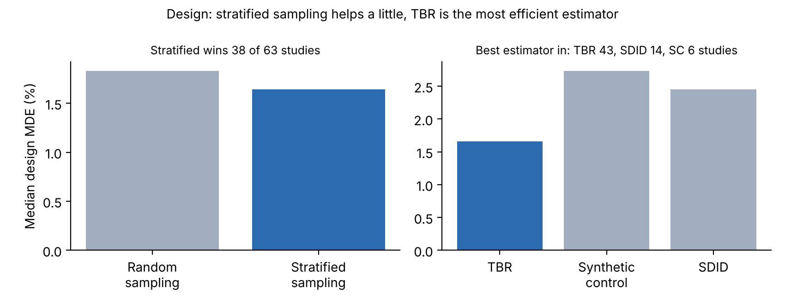
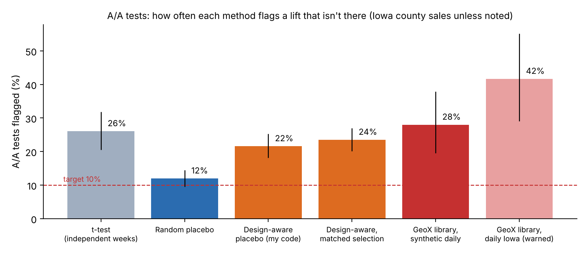
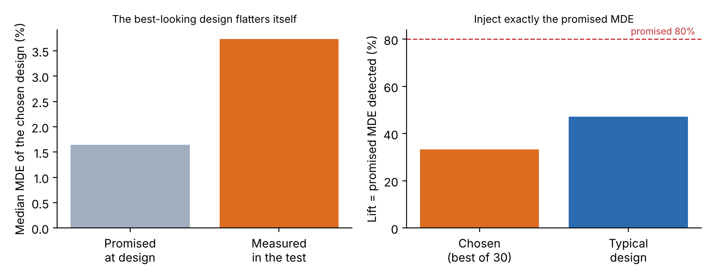

# I fed Google's geo-testing tool experiments where nothing happened. It found a lift about four times too often.

## Rebuilding Meridian GeoX on ten years of real Iowa sales, with my predictions written down before the first run.

*Part 1 of Big Tech measurement, rebuilt.*

A geo experiment is the measurement tool you reach for when you can't track individual people. You turn ads on in some regions, leave the others alone, and compare. I ran them in my agency days, and the hard part was never the arithmetic. It was deciding how much to trust the answer. Regions are few, noisy and all different, and one bad week in one big city can look exactly like a campaign working.

In September, Google released [Meridian GeoX](https://research.google/pubs/pub1090193/), an open-source framework for designing and analyzing these tests, with [a paper](https://storage.googleapis.com/gweb-research2023-media/pubtools/1043733.pdf) by Steven Ye, Fabian Sinn, Yunxiao Li and Yang Jiao. Its results are also meant to become priors in Meridian, the media mix model I used at Popeyes. A tool that feeds the model that decides budgets deserves a careful look, so I gave it one.

## What GeoX does

GeoX makes three choices. First, it picks test and control regions by stratified sampling: it groups regions with similar sales patterns and draws the test group from every group, so the two sides look alike before the test starts. Second, it predicts what the test regions would have sold without the campaign. The main method is time-based regression (TBR), a straight-line fit of test-region sales on control-region sales before the campaign, with synthetic control and synthetic difference-in-differences (SDID) as alternatives. Third, it decides whether the result is real with what the authors call design-aware placebo inference. It builds many fake test groups out of the control regions, using the same rules that built the real one, and asks whether the real result stands out from the fakes.

The paper reports that this last step keeps the false positive rate at its nominal level, while cutting the minimum detectable effect (MDE, the smallest lift a test can reliably find) by about 30% compared with fake groups drawn at random.

## How I tested it

You can't check a measurement tool on data where you don't know the answer, so I used real sales with fake experiments on top. Iowa publishes every liquor sale from the state wholesaler to stores, back to 2012. I summed it to weekly sales by county and cut it into 63 studies. Each study is a 50-week window: 26 weeks to train, 8 to validate, 8 to check the design, and 8 for the test. Depending on the years, between 36 and 95 counties had complete data.

In each study I ran 100 A/A tests, where nothing happens in the test weeks, and I injected known lifts into the test counties to see whether they were found. Before running anything, I wrote down seven hypotheses with pass or fail rules and committed them to git, so the date shows they came first. I rebuilt every step from the paper myself, and later, because the main result surprised me, I also ran Google's own library.

*Figure 1. The pre-registered hypotheses, the rule each had to meet, and what happened.*

## What held up

The estimates themselves were good. When I injected a 5% lift, the average estimate was off by only 0.1 to 0.2 percentage points. TBR was also the most efficient of the three methods, as the paper says. Its median detectable effect was 1.7%, against 2.5% for SDID and 2.7% for synthetic control, and it was the best choice in 43 of 63 studies.

Stratified sampling helped, but less than I expected. It beat random sampling in 38 of 63 studies, with a 12% smaller median detectable effect, which missed my pre-registered bar narrowly (p = 0.065). The paper also says synthetic control gains ground when data is noisy. In my studies the relationship went slightly the other way, though not significantly.

*Figure 2. Left: median MDE of the best design under random and stratified sampling. Right: median MDE of the three methods on the same designs.*

## What didn't: the uncertainty

The hypothesis I cared most about was the false positive rate. At a 10% significance level, an honest test flags about 10% of experiments where nothing happened. The design-aware placebo test, as I implemented it, flagged 22% of my 6,300 A/A tests. A plain t-test that treats weeks as independent flagged 26%, which is the failure the paper warns about. The surprise was that the simpler method Google says it improves on, fake groups drawn at random, came closest at 12%. My pre-registered check that the intervals cover a real 5% lift 85% to 95% of the time failed as well: they covered it 44% of the time for the designs the procedure picked.

*Figure 3. Share of A/A tests flagged as significant at the 10% level, with 95% intervals. The dashed line is what an honest test should show.*

This also changes how to read the power gain. Design-aware placebos did cut the detectable effect in my runs, by 42%, more than the paper's 31%. But a test always looks more powerful when its error bars are too narrow.

## Checking my own code

My first assumption was a bug, so I went looking. One theory was that I picked the fake groups more strictly than the real designs. I matched the selection exactly, and the rate stayed at 23%. Another was that the fake groups were smaller than the real ones. I matched their size and their share of sales, and it stayed at 21%. Then I measured the spread directly. Within a study, the real A/A results varied with a standard deviation of 3.4 on the test's scale. The design-aware fake groups varied by only 2.6, and the random ones by 4.4. Fake groups built with the same balancing rules came out more alike than real designs are, so the yardstick was too short.

The cleanest check was a negative control. I generated synthetic panels where every region is interchangeable by construction, with sizes as varied as real counties, a shared weekly shock and independent noise, and ran the same pipeline. My design-aware placebo flagged 15% there, my random placebo 12%, and the t-test 47%. So my version is slightly overconfident even on clean data, and real county data makes it much worse.

## Then I ran Google's library

I installed the `meridian-geox` package and ran it with its defaults on the same Iowa data, at daily grain as it expects. For each of 61 windows (it declined to analyze one) it designed the test on 24 weeks of history, picked its best design, and analyzed the next 28 days. With no lift, it flagged 42% of the 60 windows at the 10% level. With a 5% lift, its estimates averaged 5.3%, so the point estimate was right again, but its 90% interval contained the true lift only 58% of the time.

I ran the same library on the synthetic panels where regions are interchangeable, and it flagged 28% of 100 A/A tests. One possible cause was that the analysis measures the model's fit error on the same final weeks the design step used to pick the best design. Leaving a 28-day gap between the two didn't fix it: 23% on synthetic data and 48% on Iowa. I may be calling the library in a way its authors didn't intend, so the scripts are in the repository, and I would like to hear if I am.

## The design that promised too much

My last test was the one I most expected to break. GeoX picks the design with the smallest detectable effect out of many candidates, and the best of many is usually partly lucky. So I injected a lift exactly equal to the detectable effect each chosen design promised. An honest promise is kept about 80% of the time. It was kept 33% of the time. The chosen designs promised a median of 1.6%, and the test weeks delivered 3.7%. Designs that weren't picked as the best did better, at 47%, but still well short.

*Figure 4. Left: the MDE the chosen design promised, and the MDE measured in its test weeks. Right: how often a lift equal to the promised MDE was detected.*

## Limits of this study

This is one public dataset. Iowa's numbers are orders from stores, which are lumpy, especially by day, and counties aren't the media markets advertisers use. My design search simplifies GeoX's. Google evaluated the method on 192 advertisers' data and reported clean results, and their data may simply behave better than mine. What I can say is narrower: on a real dataset anyone can download, and on synthetic data built to be easy, both my implementation and Google's were more confident than they should have been, while their point estimates were fine.

## What I take from it

Before trusting any geo test tool, including this one, I'd backtest it on my own history. Take two years of sales, pretend a campaign ran in a dozen past periods when nothing happened, and count how often the tool says something did. It costs an afternoon and tells you how wide your error bars really are. That matters even more when the result becomes a prior in a media mix model, because an interval that's too tight there quietly pulls every channel's ROI toward one test. And when a tool picks the best of many designs, I'd budget for a detectable effect about twice the size it promises.

---

*Notebook, data and code: [github.com/ZFayFay/geox-replication](https://github.com/ZFayFay/geox-replication). The pre-registration is the first commit, and the runs of Google's library are in `libcheck/`. GeoX belongs to Steven Ye, Fabian Sinn, Yunxiao Li, Yang Jiao and the Google Meridian team. This is an independent test of their [paper](https://research.google/pubs/pub1090193/) and [open-source code](https://github.com/google/meridian-geox). Any mistakes are mine.*
