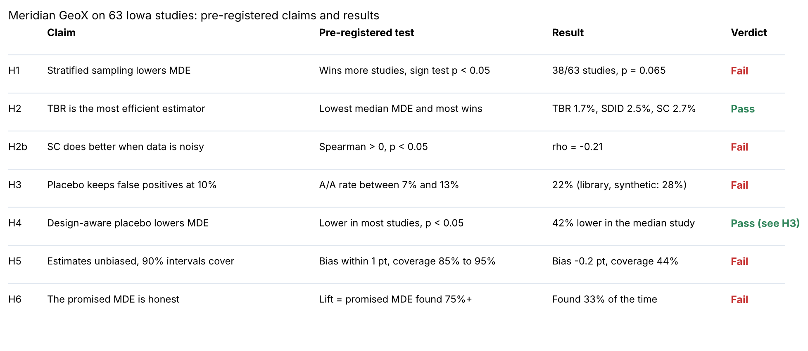

# I tested Google's geo-experiment tool on experiments where nothing happened

## Meridian GeoX estimated lifts accurately on ten years of Iowa sales. Its error bars were too narrow: my rebuild of its method flagged a lift in 22% of no-change tests against a 10% target, and Google's own library flagged 28% on synthetic data with no gaps.

A geo experiment is what you reach for when you can't track individual people. You turn ads on in some regions, leave others alone, and compare. I ran them in my agency days, and the hard part was deciding how much to trust the answer. Regions are few, noisy and all different, and one bad week in one big city can look like a campaign working. In September Google released [Meridian GeoX](https://research.google/pubs/pub1090193/), an open-source framework for designing and reading these tests, and its results are meant to feed priors into Meridian, the media mix model I used at Popeyes. So I tested it. The point estimates held up well. The uncertainty did not: tests where nothing happened came back significant two to three times as often as they should.

## What GeoX does

GeoX, by Steven Ye, Fabian Sinn, Yunxiao Li and Yang Jiao, makes three choices. It picks test and control regions by stratified sampling: it groups regions with similar sales and draws the test group from every group, so the two sides look alike before the test. It predicts what the test regions would have sold without the campaign, mainly with time-based regression (TBR), a straight-line fit of test-region sales on control-region sales, with synthetic control and synthetic difference-in-differences (SDID) as alternatives. And it decides whether a result is real with what the authors call design-aware placebo inference: it builds many fake test groups out of the control regions, using the same rules that built the real one, and asks whether the real result stands out from the fakes.

The paper reports that this inference keeps the false positive rate at its nominal level, based on A/A tests on synthetic data built from 192 advertisers, while plain t-tests run too hot because daily sales are autocorrelated. That is a careful and useful result, and it was the claim I most wanted to check.

## How I tested it

You can't check a measurement tool on data where you don't know the answer, so I used real sales with fake experiments on top. Iowa publishes every liquor sale from the state wholesaler to stores, back to 2012. I summed it to weekly sales by county and cut it into 63 studies, each a 50-week window with 26 weeks to train, 8 to validate, 8 to check the design and 8 for the test. Between 36 and 95 counties had complete data, depending on the years.

In each study I ran 100 A/A tests, where nothing happens in the test weeks, and I injected known lifts to see whether they were found. Before running anything I wrote down seven hypotheses with pass or fail rules and committed them to git. I rebuilt each step from the paper myself, and later, because the main result surprised me, I also ran Google's library.

*Figure 1. The seven pre-registered hypotheses and their results.*

## What held up

The estimates were good. When I injected a 5% lift, the average estimate was off by only 0.1 to 0.2 percentage points. TBR was also the most efficient of the three methods, as the paper says: its median detectable effect was 1.7%, against 2.5% for SDID and 2.7% for synthetic control, and it was the best choice in 43 of 63 studies. Stratified sampling beat random sampling in 38 of 63 studies, with a detectable effect 12% smaller in the median study, which narrowly missed my pre-registered bar (p = 0.065).

## What didn't: the uncertainty

At a 10% significance level a calibrated test flags about 10% of experiments where nothing happened. My rebuild of design-aware placebo inference flagged 22% of 6,300 A/A tests (95% interval 18% to 25%, counting each study as one cluster). The median study, the measure the paper reports, came in at 19%. A plain t-test flagged 26%, the failure the paper warns about. Fake groups drawn at random, the simpler method the paper improves on, came closest at 12%. And the 90% intervals around a real 5% lift contained it only 44% of the time.

*Figure 2. Share of A/A tests flagged at the 10% level, with 95% intervals.*

I first suspected a bug, so I checked. Matching how strictly the fake groups were selected left the rate at 24%. Matching their size and share of sales left it at 21%. Then I measured the spread directly. Within a study, real A/A results varied with a standard deviation of 3.4 on the test's scale, but design-aware fake groups varied by only 2.6. Fake groups built with the same balancing rules came out more alike than real designs are, so the yardstick was too short.

The size of the regions turned out to matter. On synthetic panels where every region is the same size, my rebuild was well calibrated at 11%. When the synthetic regions varied in size nearly as much as Iowa's counties, it rose to 15%. On Iowa itself it was 21% to 22%, depending on the random draw, and dropping Polk County, home of Des Moines and 23% of state sales, brought it to 18%. So the method looks fine when regions are alike and drifts as one region dominates, which is the usual case for real markets.

## Then I ran Google's library

My rebuild could be wrong, so I ran the `meridian-geox` package (version 1.0.1) with standard settings: TBR and stratified sampling. It expects daily data, so I fed it daily county sales over 61 windows of 24 weeks of history and a 28-day test. With no lift it flagged 25 of 60 windows (42%), and one window it declined to analyze. The warnings matter more here. In my rerun the library warned on every window it analyzed that more than half of the daily county cells were zero. Daily liquor orders are lumpy, and that is outside what the tool is built for, so I don't put much weight on the 42%. Part of the gap between my 22% and the library's 42% is also how the p-value is computed: version 1.0.1 uses an equal-tailed p-value, and with that definition my own rebuild flagged 45% of the Iowa tests too. On synthetic regions of equal size, the two definitions agree at about 11%.

The cleaner test is synthetic. On 100 synthetic daily panels with no zeros, where region sizes vary about as much as real counties, the library flagged 28% of A/A tests (95% interval 20% to 38%), and its 90% interval contained a real 5% lift 71% of the time. The current version on GitHub gave 31% on the same kind of data. Rerunning the library from scratch for 45 of the Iowa windows and all 100 synthetic panels reproduced my saved results exactly. I did not run the library on equal-size regions, where my own rebuild was on target. I may still be calling the library in a way its authors didn't intend, so the scripts are in the repository, and I'd like to hear if I am.

## The design that promised too much

GeoX picks the design with the smallest detectable effect out of many candidates, and the best of many is usually partly lucky. The paper says GeoX calibrates its detectable effects by simulation to guard against that, and my rebuild does not, so this test is harder on my version than on theirs. I injected a lift exactly equal to the detectable effect each chosen design promised. A design should catch that lift about 80% of the time. The chosen designs caught it 33% of the time. They promised a median of 1.6%, and the test weeks needed 3.7%. A typical design that was not picked caught it 47% of the time, so most of the gap comes from the narrow placebo spread, not only from picking the best. Google's library showed the same pattern on synthetic data, catching the promised lift 53% of the time.

*Figure 3. Left: the detectable effect the chosen design promised and the one measured in the test. Right: how often a lift equal to the promise was caught.*

## Limits

This is one public dataset of orders to stores, not consumer sales, and counties are not the media markets advertisers use. My design search is simpler than GeoX's. The 63 studies share counties and some years, so the intervals above are, if anything, too narrow. Google evaluated the method on 192 advertisers and reported clean results, and their data may behave better than mine. What I can say is narrower: on a dataset anyone can download, and on synthetic data with no gaps, both my rebuild and Google's library were more confident than they should have been, while their point estimates were right.

## What I take from it

Before trusting any geo-test tool, including this one, I'd backtest it on my own history. Take two years of sales, pretend a campaign ran in a dozen past periods when nothing happened, and count how often the tool says something did. It costs an afternoon and tells you how wide your error bars are. That matters more when the result becomes a prior in a media mix model, because a prior that is too confident gives that one test too much weight against everything else the model sees. And when a tool picks the best of many designs, I'd plan for a detectable effect about twice the size it promises.

---

*Notebook, data and code: [github.com/ZFayFay/geox-replication](https://github.com/ZFayFay/geox-replication). The pre-registration is the first commit, the runs of Google's library are in `libcheck/`, and the extra checks are in `checks/`. GeoX belongs to Steven Ye, Fabian Sinn, Yunxiao Li, Yang Jiao and the Google Meridian team. This is an independent test of their [paper](https://research.google/pubs/pub1090193/) and [open-source code](https://github.com/google/meridian-geox). Any mistakes are mine.*
